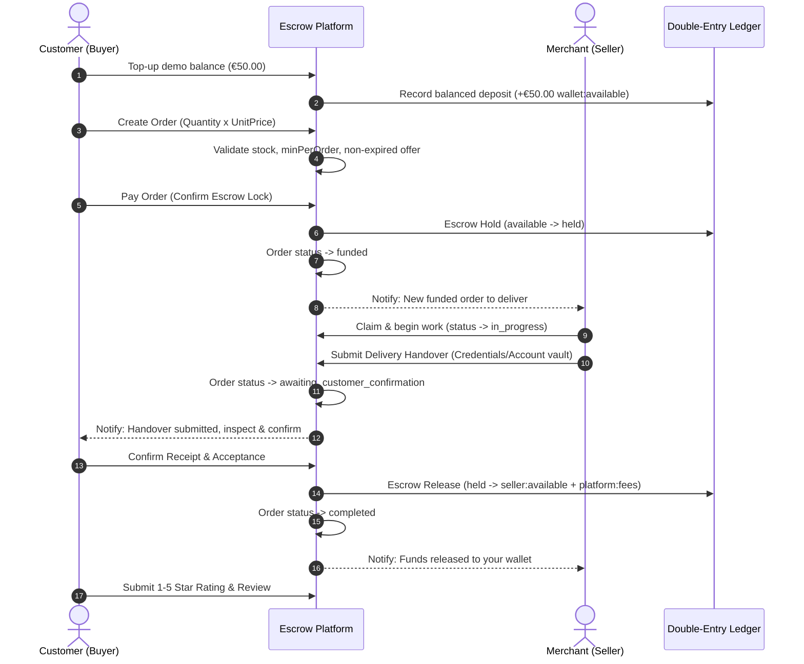
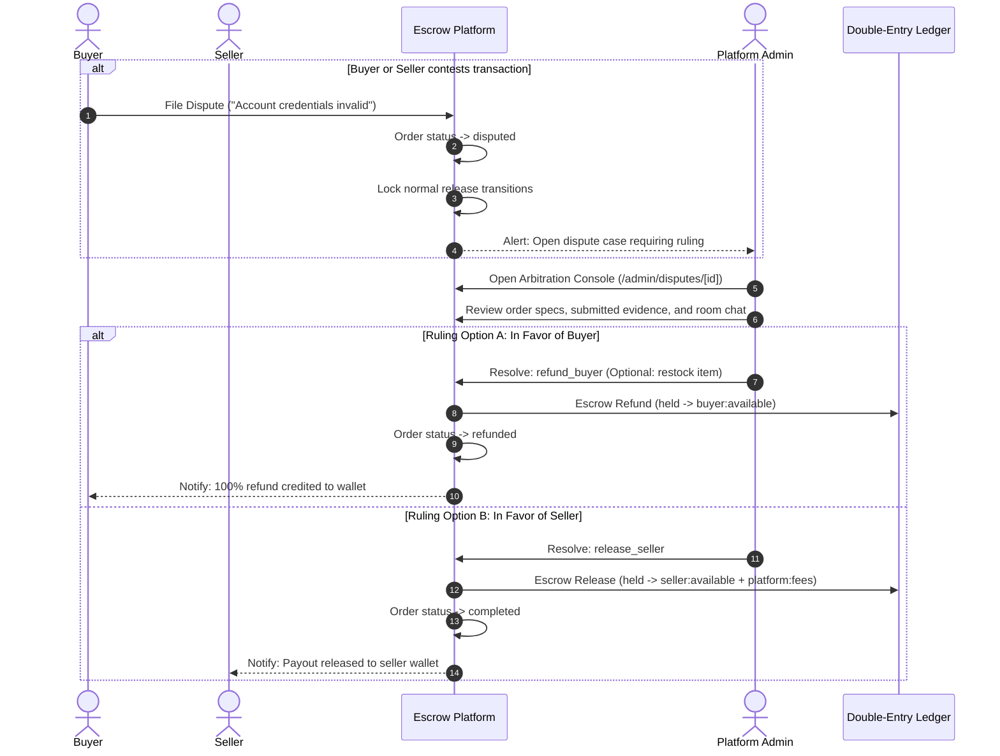

# Escrow Lifecycle & Dispute Arbitration Specification

## 1. Overview
The core value proposition of Gamer 2 Gamer is ensuring safe transactions between pseudonymous gamers. Neither party holds simultaneous custody of both funds and digital assets without platform verification.

---

## 2. Standard Transaction Flow (Two-Sided Confirmation)

---

## 3. Dispute Arbitration Flow

---

## 4. Key Invariants & Edge Cases Handled

1. **Strictly Blocked Single-Sided Release**:
   - If only the seller marks "delivered" and the buyer has not confirmed, the escrow release function will throw `ORDER_STATE_INVALID`.
2. **Dispute Release Lock**:
   - As long as `order.status === 'disputed'`, neither party can complete or cancel the order. Only an administrator can execute a binding ruling.
3. **Double Settlement Prevention**:
   - Release and refund logic checks `EscrowRecord.status === 'held'` inside a database transaction. If already released or refunded, the transaction aborts with `ESCROW_ALREADY_SETTLED`.
4. **Race Condition Stock Depletion**:
   - If two buyers attempt to purchase the final inventory item at the exact same millisecond, MongoDB conditional updates decrement stock atomically. The first buyer succeeds; the second receives `INSUFFICIENT_STOCK`.
5. **Private Vault Isolation**:
   - Order delivery account credentials are encrypted/restricted in the database and only decrypted for the buyer and seller of that specific order room. Outsiders receiving the order ID receive a `403 Forbidden` response.
